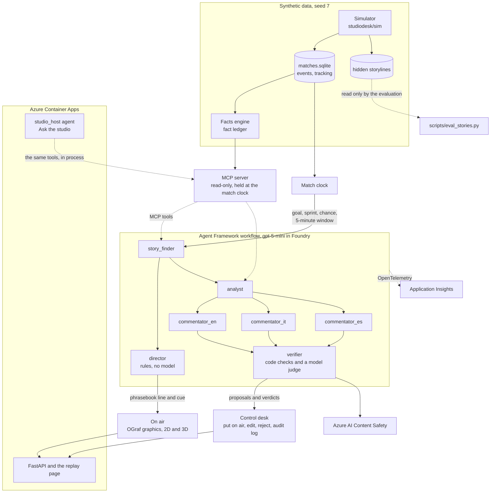

# Studio Desk

An AI production desk for a football broadcast. Agents follow a match as it is played and write the on-screen graphics in English, Italian and Spanish. Before anything goes on air, a producer approves it at the control desk.

Built for the Inside the Game hackathon, in the Best Enterprise Solution category. All match data is synthetic: every club, player and stadium is invented.

**Try it:** https://studiodesk.calmmoss-3f076252.swedencentral.azurecontainerapps.io/ (no account needed; step-by-step testing instructions for judges are in [docs/TESTING.md](docs/TESTING.md)). The pitch is in [docs/PITCH.md](docs/PITCH.md) and the video script in [docs/VIDEO-SCRIPT.md](docs/VIDEO-SCRIPT.md).

## What to try

1. Open a match and press Play. The page opens on M001; the others are [M002](https://studiodesk.calmmoss-3f076252.swedencentral.azurecontainerapps.io/?match=M002), [M003](https://studiodesk.calmmoss-3f076252.swedencentral.azurecontainerapps.io/?match=M003) and [M004](https://studiodesk.calmmoss-3f076252.swedencentral.azurecontainerapps.io/?match=M004). The seek bar has a button for each goal, and **Next key moment** jumps to the next story the agents found.
2. On a computer the picture is 3D, with the 2D pitch as a small, see-through live minimap at the bottom, as in a football game. Click the minimap to swap the two, and click it again to swap them back. **Minimap** in the settings (the gear) turns it off. The 3D view runs in your browser and uses the same tracking data; a phone starts on the 2D pitch.
3. Look at the **Desk** beside the picture (on a phone, press **Desk**). Each story lists the facts behind it, the verifier's verdict and a risk level (low, medium or high). Use **Put on air**, **Edit** or **Reject** on a story; **Undo** in the line that confirms it reverses the last decision. Stories below the risk threshold go on air automatically and are marked auto-approved in the **Audit log** tab.
4. Look at the strip under the picture. It shows which agent is working and what it passed on. While a graphic is on air, it shows how that graphic was made.
5. Switch the language to EN, IT or ES in the settings. The desk, the controls and the graphics change language. The numbers do not change, because code computes them from the fact ledger; the model never writes them.
6. Turn on **Voice** to hear approved stories read aloud in the language on screen.
7. Open **Ask the studio** and type a question about the match so far. The answer may use only facts up to the current replay time. If an answer fails the checks, the studio shows a fixed sentence instead of it.
8. Open the **Traces** tab on the desk. It lists each step with the agent, model, tokens, time and cost.
9. Turn the **AI graphics** switch on the desk off. Only the template graphics stay on air, and **Next key moment** becomes **Next goal**.
10. Change the audience in the settings: analyst, casual fan, kids, fans of one team or fans of one player. The speed and the audience show beside the gear when they are not the default.
11. Open a match at a given moment with a link: `?match=M001&t=2400&audience=casual&speed=4&play=1` starts M001 at 40:00 of match time (`t` is in match seconds) for the casual fan, at 4x, playing. Audiences are `analyst`, `casual`, `kids`, `team:<id>` and `player:<id>`, as in the settings; speeds are 1, 4, 16 and 64.

The replay makes no model calls, so it has no daily quota. Each session allows 300 desk actions and 10 questions per day, and the whole site answers 40 questions per day, to stay inside the Azure AI Content Safety free tier. Every visitor gets their own session, so your choices never reach another judge, and each match starts clean.

## How it meets the judging criteria

| Criterion | Proof | Where to check |
|---|---|---|
| Gate: theme and Microsoft technologies | A football broadcast desk built on Microsoft Agent Framework, a gpt-5-mini deployment in Microsoft Foundry, Azure Container Apps, Azure AI Content Safety, Azure AI Speech and Application Insights, deployed with Bicep and the Azure CLI, tested and built with GitHub Actions | [Live site](https://studiodesk.calmmoss-3f076252.swedencentral.azurecontainerapps.io/), [pyproject.toml](pyproject.toml), [infra/main.bicep](infra/main.bicep), [.github/workflows/](.github/workflows/) |
| Technological implementation: synthetic data | A seeded simulator writes 4 matches (5,493 events, 223,905 tracking frames at 10 fps) with 14 hidden storylines, calibrated on public event data and published physical studies. The same seed gives the same events and frames | [Synthetic data](#synthetic-data), [studiodesk/sim/](studiodesk/sim/), [docs/realism.md](docs/realism.md), [tests/test_sim.py](tests/test_sim.py) |
| Technological implementation: software practice | 541 Python tests and 176 browser-logic tests pass offline; CI runs pytest on every push and builds the image only from a commit whose tests passed; pinned versions; a written data contract | [Measured numbers](#measured-numbers), [ci.yml](.github/workflows/ci.yml), [image.yml](.github/workflows/image.yml), [docs/CONTRACT.md](docs/CONTRACT.md) |
| Agentic design and innovation | An Agent Framework workflow: story finder, then the director on air at once, then the analyst fanning out to three commentators and in again to a verifier. Agents read the match only through an MCP server whose clock follows the match. Any failed agent is replaced by rules | [workflow.py, the two workflows](studiodesk/agents/workflow.py#L854-L860), [mcp_server.py](studiodesk/mcp_server.py#L153-L157), [tests/test_mcp.py](tests/test_mcp.py#L36), [fallback test](tests/test_agents.py#L195-L227) |
| Real-world impact | A producer sees each story with its facts, risk and verdict, and puts it on air, edits or rejects it. A match costs $0.060 to $0.102 in model calls; a goal reached the director 3.7 and 5.6 s after the shot in a real-speed run; Foundry's evaluators gave the on-air texts a mean groundedness of 4.64 out of 5 | [A goal on the desk](https://studiodesk.calmmoss-3f076252.swedencentral.azurecontainerapps.io/?match=M001&t=590&speed=1&play=1), [docs/MEASURES.md](docs/MEASURES.md) |
| User experience and presentation | 3D and 2D broadcast views, OGraf graphics, three languages, five kinds of audience, voice, Ask the studio, links that open any moment | [What to try](#what-to-try), [the same goal for a fan of the other team](https://studiodesk.calmmoss-3f076252.swedencentral.azurecontainerapps.io/?match=M001&t=590&audience=team:T02&speed=1&play=1), [docs/TESTING.md](docs/TESTING.md), [docs/VIDEO-SCRIPT.md](docs/VIDEO-SCRIPT.md) |
| Category: Best Enterprise Solution | Human approval above a risk threshold (0.35), an audit log of every decision and model call, Content Safety on every approved text, a per-session AI switch, per-visitor state, daily caps and a cost stop, managed identity with no keys for the model, infrastructure as code, OpenTelemetry traces | [config.py](studiodesk/config.py#L11-L39), [tests/test_api.py](tests/test_api.py#L215-L259), [tests/test_safety.py](tests/test_safety.py), [studiodesk/telemetry.py](studiodesk/telemetry.py), [Deployment](#deployment) |

## How it works



The director puts a story on air as soon as the story finder has chosen it, with the phrasebook's lines. The analyst, the commentators and the verifier then add the analysis and their proposals to the desk.

- **Agents.** A Microsoft Agent Framework workflow running gpt-5-mini in Azure AI Foundry (Sweden Central). Agents read the match only through a Model Context Protocol (MCP) server whose clock follows the match, so they cannot see later events.
- **Fact ledger.** Every number on screen is computed by code and stored as a fact with an id; models never write numbers. The desk shows which facts a story uses.
- **Phrasebook.** Lines that go on air automatically are assembled by code from phrases written for each language. Each phrase is tied to the fact that justifies it: "What a hit!" is used only for a shot of 100 km/h or more, and "strikes again" only for a player's second goal. The story finder chooses the tone and what the line leads with (for example where the shot came from, its distance or its speed). The verifier checks the commentators' own lines against the facts, and they wait on the desk as proposals that a person can put on air with one click.
- **Safety.** Approved texts pass through Azure AI Content Safety. The result is stored with the story, and a story that fails the check is held back.
- **Fallbacks.** If an agent fails or times out, rules and template sentences take its place and the broadcast carries on. The trace records the fallback.
- **Voice.** Azure AI Speech records the verified stories ahead of time in English, Italian and Spanish. A clip plays only if its checksum matches the text on screen.
- **Ask the studio.** A `studio_host` agent answers a visitor's question with the same MCP tools, called in process, on a clock held at the replay time. Code checks the answer before it is shown: every number must be a cited fact with its unit, a score must be the score at that moment, the answer must contain no link and no real name and be in the visitor's language, and Content Safety must pass both the question and the answer.
- **Graphics.** Broadcast graphics are HTML in the open EBU OGraf format (`web/graphics/`). On a small screen they switch to a compact layout, and the text is never smaller than 11 px.
- **3D view.** Babylon.js draws the players from the tracking data and adds a broadcast camera, goal replays and celebrations. On a device that is too slow it suggests the 2D pitch. For visitors who ask for reduced motion, it keeps the wide broadcast camera and makes no cuts.

The data contract, from the tables to the API, is in [docs/CONTRACT.md](docs/CONTRACT.md).

## Synthetic data

Every match comes from our own simulator in `studiodesk/sim/`. No real match data is shipped or replayed.

**What it generates.** `python -m studiodesk.sim build --matches 4 --seed 7` writes `data/matches.sqlite`: 8 invented clubs with crests and venues, 144 invented players, and 4 full matches with 5,493 events in the SPADL action format (1,364 to 1,383 a match) and 223,905 tracking frames at 10 fps for the ball and both squads. The engine is a possession state machine (possession, action, outcome) that runs on ball-in-play time. Dead-ball time is inserted afterwards, and the tracking is generated around the events, within each player's top speed and an acceleration cap of 5 m/s². Every generated name is checked against `data/forbidden_names.txt`. On our 8 GB build machine the four matches took 25 s to build, and the facts engine then wrote 20,825 facts in 5 s.

**Hidden storylines.** The simulator also plants storylines in a `storylines` table that the agents, the MCP server and the API never read (`tests/test_mcp.py` checks the server). There are four kinds: a tactical shift (a new formation or a higher defensive line, between the 56th and the 66th minute in these four matches), a spell of high pressing lasting 5 to 10 minutes, a sprint above 34 km/h by the fastest forward in the starting line-ups, and a comeback, planted in half of the matches. The four matches hold 14 storylines, and the agents found 11. `scripts/eval_stories.py`, the only code that reads the table, counts a storyline as found when a story of the matching kind, for the same team (and the same player, when the storyline names one), starts within 60 seconds of it.

| storyline | planted | found by the agents |
|---|---|---|
| tactical shift | 4 | 4 |
| top sprint | 4 | 4 |
| comeback | 2 | 2 |
| high press | 4 | 1 |

**Calibration.** `scripts/calibrate.py` ran once, offline, on the public Wyscout event data published by Pappalardo et al. (Scientific Data, 2019): the 2017/18 Italian, Spanish, German and French first divisions. The English first division is excluded in code. Only averages (`studiodesk/sim/wyscout_averages.json`, copied into `studiodesk/sim/calibration.json`) and a 16x12 expected-threat grid (`studiodesk/facts/xt_grid.json`) are committed, with no raw rows. Running distance and sprints come from published studies: sprints above 24 km/h, 11.2 per player per match (Andrzejewski et al., 2013), and 10,841 m per player (Bradley et al., 2010). Each value carries its source in `calibration.json`, and the licences are in [THIRD_PARTY.md](THIRD_PARTY.md). `python -m studiodesk.sim report` compares the four matches with the calibration ([docs/realism.md](docs/realism.md)):

| metric | calibration | simulated, mean of the 4 matches |
|---|---|---|
| actions per team per match | 635 | 687 |
| pass share | 0.69 | 0.67 |
| pass success rate | 0.83 | 0.84 |
| mean pass length (m) | 20.1 | 20.9 |
| shots per match | 23.6 | 19.2 |
| goals per match | 2.71 | 3.00 |
| sprints per player | 11.2 | 9.3 |
| distance per player (m) | 10,841 | 10,936 |

**Seed and rebuild.** Seed 7 builds the four replay matches, and the same seed gives the same events and frames (`tests/test_sim.py`). CI rebuilds the seed on every push, so `tests/test_replays.py` can check that every fact and event id in the committed agent replays exists in the rebuilt data. To rebuild, run the first two commands of [Run it locally](#run-it-locally). The site also serves the exported files of each match, for example the [events](https://studiodesk.calmmoss-3f076252.swedencentral.azurecontainerapps.io/data/M001/events.json), [facts](https://studiodesk.calmmoss-3f076252.swedencentral.azurecontainerapps.io/data/M001/facts.json), [stories](https://studiodesk.calmmoss-3f076252.swedencentral.azurecontainerapps.io/data/M001/stories.json) and [agent traces](https://studiodesk.calmmoss-3f076252.swedencentral.azurecontainerapps.io/data/M001/traces.json) of M001.

## Measured numbers

The test counts and the run with the model off were measured on commit `abd9990` on 25 Oct 2026. The other numbers come from the Azure runs that made the replays, computed by `scripts/measures.py` into [docs/MEASURES.md](docs/MEASURES.md).

**Tests.** `.venv/bin/pytest -q`: 541 passed in 3 min 18 s. `node --test tests/web/*.test.mjs`: 176 passed in 2 min 11 s. Both run offline after the build in [Run it locally](#run-it-locally); the browser-logic tests also need the test fixture from `.venv/bin/python scripts/make_demo_fixture.py`. GitHub Actions runs pytest on every push.

**Delay from event to graphic.** In a real-speed run on Azure (M001, minutes 5 to 20, `python -m studiodesk.agents run M001 --speed 1 --from-ts 300 --to-ts 1200`), the 2 goals reached the director's cue 3.7 and 5.6 seconds after the shot, and the big chance 9.7 seconds after it, once the play had settled. These are upper bounds. A full round of agents (story finder, director, analyst, three commentators, verifier and rewrites) took 16.7 seconds at the median and 34.1 seconds at most, so the analysis and the proposals reach the desk after the graphic is already on air.

**Tokens and cost per match.** Counted from the audit table, one row per model call, at the gpt-5-mini price in `studiodesk/config.py`:

| match | model calls | tokens in / out | cost (USD) |
|---|---|---|---|
| M001 | 132 | 237,248 / 17,030 | 0.063 |
| M002 | 210 | 375,275 / 25,467 | 0.095 |
| M003 | 121 | 219,293 / 16,643 | 0.060 |
| M004 | 229 | 402,181 / 28,181 | 0.102 |
| all | 692 | 1,233,997 / 87,321 | 0.319 |

The Content Safety checks (one call per story, 83 in all) are not in these counts.

**Stories and checks.** The four replays put 83 stories on air, all with code-written phrasebook text. In 67 of them the AI's own line passed every check in all three languages and waits on the desk as a proposal. The verifier sent back or dropped 5 drafts because of a number (not in the fact ledger, in words, or with the wrong unit) and 0 because of a real name; these are lower bounds. Run again today, the verifier's code checks in `scripts/eval_stories.py` flag 0 of the 83 on-air texts in each of the three languages.

**Fallback when the model is off.** `tests/test_agents.py` makes each agent fail in turn, then all of them, then every call time out, and checks that the stories still air in all three languages. On 25 Oct 2026 we also ran the whole of M001 offline with every model call failing: 15 stories in 44.9 s of wall time, with the match clock not waiting for real time, every one on air with its phrasebook line in English, Italian and Spanish, 70 trace steps marked as fallbacks, and 0 model calls. On the site, the **AI graphics** switch on the desk shows the same broadcast with template graphics only.

The four replays in `replays/` come from real runs on Azure, and their files hold the stories and every agent step. Model calls for one match cost between $0.060 and $0.102 (236,000 to 430,000 tokens), taken from each run's audit. Stories found, numbers blocked, tokens, cost and timing for each match are in [docs/MEASURES.md](docs/MEASURES.md).

**Foundry evaluators.** The on-air texts were also scored by Microsoft Foundry's built-in evaluators, with gpt-5-mini as the judge, through the Agent Framework's `FoundryEvals`: 249 items, every story of the four replays in English, Italian and Spanish. The judge read each text against the facts and events it cites. Mean scores out of 5: groundedness 4.64 (243 of 249 passed), relevance 4.23, coherence 4.36 and fluency 3.47 (249 of 249 passed each). Five of the six groundedness failures are lines that say a player "strikes again" or "tries again" when the earlier goal or shot is not among that story's facts. In the sixth, the judge read a defensive line moving from 15.7 m to 48.5 m from goal as a deeper line. The run cost about $1.33 in judge tokens. To rerun it: `.venv/bin/python scripts/foundry_evals.py` (it calls Azure and needs the Foundry User role on the `studiodesk` project). The table and the details are in [docs/MEASURES.md](docs/MEASURES.md#foundry-evaluators).

## Run it locally

Requires Python 3.12.

```
python -m venv .venv && .venv/bin/pip install -e '.[dev]'
.venv/bin/python -m studiodesk.sim build --matches 4 --seed 7
.venv/bin/python -m studiodesk.facts build --all
for m in M001 M002 M003 M004; do .venv/bin/python -m studiodesk.export $m; done
cp -r replays/. web/data/
.venv/bin/uvicorn studiodesk.api:app --port 8000
```

The export builds the tracking data and the template graphics; the copy adds the recorded agent output. Then open http://127.0.0.1:8000/. The replay needs no Azure account. To run the agents yourself, install the extras with `.venv/bin/pip install -e '.[dev,agents]'`, then use `.venv/bin/python -m studiodesk.agents run M001 --fake` for an offline model, or set `AZURE_OPENAI_ENDPOINT` and sign in with the Azure CLI to use the real one.

Tests run offline and never call a paid service: `.venv/bin/pytest -q` and, after `.venv/bin/python scripts/make_demo_fixture.py`, `node --test tests/web/*.test.mjs`. The browser checks in `tests/web/` (layout, desk, 3D, voice) run with `scripts/with-lock.sh chromium tests/web/run-smoke.sh <check>.mjs`. GitHub Actions runs pytest on every push and builds the container image from main once the tests pass.

## Deployment

One container on Azure Container Apps (consumption plan, at most one replica, scaled to zero when idle), with its image on GitHub Container Registry. The image workflow builds it from a main commit whose tests passed, and the Azure CLI deploys it with `IMAGE=ghcr.io/guepe99/studio-desk:<sha> ADMIN_TOKEN=<token> az deployment group create -g rg-studiodesk -p infra/rg-studiodesk.bicepparam`. The container reaches Foundry and Content Safety through its managed identity, with the Cognitive Services OpenAI User and Cognitive Services User roles. Visitors cannot start live agent runs; the replays show agent output recorded on Azure. Desk decisions are stored per session inside the container (`runtime.sqlite`), so deploying a new revision resets them.

Besides the Traces tab, the agents send OpenTelemetry traces to Azure Application Insights (`studiodesk-insights`, on the Log Analytics workspace `log-studiodesk`, both capped at 0.1 GB a day) when `APPLICATIONINSIGHTS_CONNECTION_STRING` is set, in the Container App or for a local `python -m studiodesk.agents run` (`studiodesk/telemetry.py`). Microsoft Agent Framework's own spans carry the GenAI attributes: `invoke_agent <agent>`, `chat <model>` with token usage, `execute_tool` and the MCP `tools/call`. Each Ask the studio question is an `ask_studio` span, and each verifier verdict a `studiodesk.verdict` event with its short reason. Message content, the visitor's question and client addresses stay out. The infrastructure is in `infra/` (Bicep): `monitoring.bicep` for the workspace and Application Insights, `main.bicep` for everything else in the resource group (the Foundry account and project with the gpt-5-mini deployment, Content Safety and Speech on F0, the Container Apps environment and app, and the app identity's two role assignments), and `rg-studiodesk.bicepparam` for the values of the live group. Speech is used only offline, to record the voice-over, with its key read through the Azure CLI; the comments in `main.bicep` say what code change would remove that key and the Content Safety key fallback.

To build the environment from scratch, sign in with `az login`, then run `az group create -n <group> -l swedencentral` and `az deployment group create -g <group> -f infra/main.bicep -p image=ghcr.io/guepe99/studio-desk:<sha> adminToken=<token> aiName=<unique name>`. The Foundry account name is also its subdomain, so it must be new. A subscription can hold only one free F0 account of each kind, so a second environment in the same subscription needs `S0` for Content Safety and Speech in `main.bicep`. Check a change first with `az deployment group what-if` and the same arguments.

## Limits

- **Synthetic matches only.** The system has never run on a real data feed. The simulator stays close to its calibration on passes, running distance and actions, but it makes fewer shots (19.2 a match against 23.6), more goals (3.0 against 2.71) and fewer sprints (9.3 per player against 11.2).
- **Pressing spells are hard to find.** The agents found 1 of the 4 planted spells of high pressing, and 1 of the 6 pressing stories they wrote matches a planted spell.
- **The rules do much of the finding.** With every model call failing, the rule fallback on M001 produced 15 stories at the same moments and of the same kinds as the run with the model, and found the same 3 of its 4 hidden storylines. The model chooses the tone and the angle, writes the analysis and the proposals, and judges the claims without numbers.
- **The AI's own lines never air by themselves.** In the four replays all 83 stories went on air with phrasebook text; the 67 AI lines that passed every check wait on the desk until a person puts them on air.
- **No live runs for visitors.** `POST /api/live` answers 501, and the replays show agent output recorded on Azure. The delay from event to graphic was measured on 15 minutes of one match; the numbers are upper bounds.
- **Free tiers.** Content Safety and Speech run on the F0 tier, so Ask the studio answers 40 questions a day for the whole site, and it pauses if the Content Safety quota runs out.
- **One replica, scaled to zero.** On 25 Oct 2026 the first request after an idle spell took 31.6 s and the next ones about 0.1 s. Desk decisions live in a SQLite file inside the container, so a new revision resets them.
- **The judge is the same model.** The Foundry evaluators used gpt-5-mini to judge gpt-5-mini's work, and fluency scored 3.47 out of 5, the lowest of the four.
- **Not counted.** The Content Safety calls are not in the token and cost figures.
- **Three languages, 3D on computers.** English, Italian and Spanish only. The 3D view needs WebGL 2 on a computer, and phones get the 2D pitch.

## How it was built

Written with Claude Code (Anthropic).
<!-- COPILOT: TODO for the lead. GitHub Copilot has not been used yet. If it is used before the submission, say here what it did (which files, which agent mode task); otherwise delete this line. -->
GitHub Actions runs the tests and builds the container image (`.github/workflows/`). The GitHub CLI (`gh`) runs and downloads workflow runs (`gh workflow run booth-render.yml`, `gh run download`), and `image.yml` uses `gh api` to check that a commit passed CI before a manual build. The Azure CLI deploys the Bicep templates in `infra/` and provides the local sign-in the agents use through `DefaultAzureCredential`.

Third-party material is listed with its licence in [THIRD_PARTY.md](THIRD_PARTY.md).

## Licence

MIT, see [LICENSE](LICENSE).
