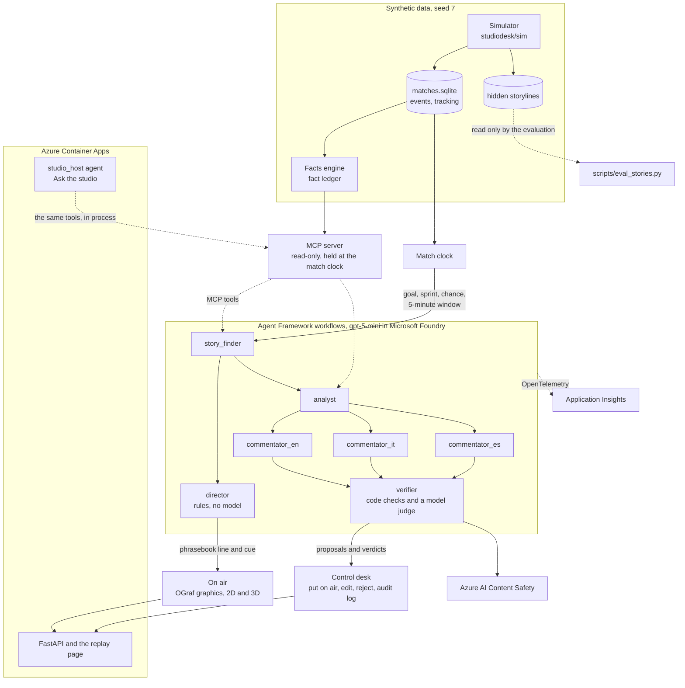

# Studio Desk

[](https://github.com/Guepe99/studio-desk/actions/workflows/ci.yml)

An AI production desk for a football broadcast. Agents follow a match as it is played, pick the moments worth a story and explain them, and code builds the on-screen graphics from a ledger of computed facts, in English, Italian and Spanish. The producer approves the riskier stories at the control desk; low-risk ones, such as goals, go on air by themselves and are logged as auto-approved. The agents' own lines wait on the desk as proposals until the producer uses one.

Built for the Inside the Game hackathon, in the Best Enterprise Solution category. All match data is synthetic: every club, player and stadium is invented.

**Try it:** https://studiodesk.calmmoss-3f076252.swedencentral.azurecontainerapps.io/

No account is needed, and [docs/TESTING.md](docs/TESTING.md) is a five-minute walkthrough for judges. The pitch is in [docs/PITCH.md](docs/PITCH.md) and the video script in [docs/VIDEO-SCRIPT.md](docs/VIDEO-SCRIPT.md).

## Who would use it

A broadcaster, or a league's production team, that wants on-air graphics drawn from match data and wants a producer to approve the riskier ones before they air. Each extra language or audience is one more set of graphics from the same fact ledger. A match costs $0.06 to $0.10 in model calls.

It fits the tools a gallery already has. The graphics are HTML in OGraf, the EBU's open format for broadcast graphics, and every cue is a timed JSON record with its graphic, audience, language and data (`web/data/<match>/cues.json`).

A first pilot: run Studio Desk beside the broadcaster's existing graphics for one live match, on a broadcast delay, with the producer working the desk and nothing going to air. Measure how many stories the producer would have aired, how many they edited or refused, and how many contained a wrong name or number.

## What to try

1. Open a match and press Play. The page opens on M004, the match where the most graphics wait for the producer; the others are [M001](https://studiodesk.calmmoss-3f076252.swedencentral.azurecontainerapps.io/?match=M001), [M002](https://studiodesk.calmmoss-3f076252.swedencentral.azurecontainerapps.io/?match=M002) and [M003](https://studiodesk.calmmoss-3f076252.swedencentral.azurecontainerapps.io/?match=M003). The seek bar gets a button for each goal once the replay has reached it, and **Next key moment** jumps to the next story the agents found. On a first visit a short welcome offers **Watch the first goal, with sound** or **Start from kick-off**.
2. On a computer with a graphics card the picture is 3D, with the 2D pitch as a small, see-through live minimap at the bottom, as in a football video game. Click the minimap to swap the two, and click it again to swap them back. **Minimap** in the settings (the gear) turns it off. The 3D view runs in your browser and uses the same tracking data. A phone, or a computer that draws without a graphics card (a virtual machine or a remote desktop), starts on the 2D pitch; add `&view=split` to the link to bring the 3D view back.
3. Look at the **Desk** beside the picture (on a phone, press **Desk**). Each story lists the facts behind it, the verifier's verdict and a risk level. While the code's phrasebook line is on air, the risk follows the story's kind: a fact (a goal, a comeback, a sprint, a recap) is low, and a reading of the game (a big chance, a change of shape, who is on top) is medium. Use **Put on air**, **Edit** or **Reject** on a story, or open **Details** and press **Use proposal** to put the agents' own line on air; the confirmation that appears has an **Undo** button. Stories below the risk threshold go on air automatically and are marked auto-approved in the **Audit log** tab.
4. Look at the **Agents at work** strip under the picture. It shows which agent is working and what it passed on. While a graphic is on air, it shows how that graphic was made.
5. Switch the language to EN, IT or ES in the settings. The desk, the controls and the graphics change language. The numbers do not change, because code computes them from the fact ledger; the model never writes them.
6. Press **Voice** under the picture to hear the stories on air read aloud, at 1x speed, in the language on screen.
7. Open **Ask the studio** and type a question about the match so far. The answer may use only facts up to the current replay time. If an answer fails the checks, the studio shows a stock reply instead.
8. Open the **Traces** tab on the desk. It lists each step with the agent, model, tokens, time and cost.
9. Turn off the **AI graphics** switch on the desk. Every story goes off air, approved ones included, and only the template graphics (line-ups, name plates, pass and shot cards, and the Momentum panel) stay; the Team shape panels, also built by code, still wait for you under **Needs you**. **Next key moment** becomes **Next goal**.
10. Change the audience in the settings: analyst, casual fan, kids, fans of one team or fans of one player. When the speed or the audience is not the default, it appears beside the gear.
11. Open a match at a given moment with a link: `?match=M001&t=2400&audience=casual&speed=4&play=1` starts M001 at 40:00 of match time (`t` is in seconds), at 4x speed, for a casual fan, already playing. Audiences are `analyst`, `casual`, `kids`, `team:<id>` and `player:<id>`, as in the settings; speeds are 1, 4, 16 and 64; `view` is `2d`, `3d` or `split`.
12. Set **Broadcast delay** in the settings to 10 s, or add `&delay=10` to the link, as in [the 10' goal of M001](https://studiodesk.calmmoss-3f076252.swedencentral.azurecontainerapps.io/?match=M001&t=586&delay=10&play=1). The desk runs at the live time and the picture 10 seconds behind, as on live TV: the goal graphic lands on the shot, and the desk shows each story before viewers see it ([docs/delay.md](docs/delay.md)).
13. Open the [multiviewer](https://studiodesk.calmmoss-3f076252.swedencentral.azurecontainerapps.io/multiview.html?match=M001), as in a broadcast gallery: one producer desk, the same goal for an analyst, kids, a fan of the other team and a casual fan, in English, Italian and Spanish, all four in sync under one Play button. Click a window to make it large and hear its commentary (the green tally), the other three shrink beside it; on a computer with a graphics card the large window switches to the 3D view. Click it again for all four. The producer's desk sits beside the wall: a decision there, or the AI switch, applies to all four windows. **Multiview** in the settings menu opens it from the page.
14. In **Ask the studio**, press **Speak** beside the question box and say your question in the page's language (10 seconds at most), then **Stop**. Azure Speech writes it into the box; check it and press **Ask**. The button appears only in a browser that can record, and the browser asks for the microphone on the first press.
15. Open the settings (the gear) and pick **Highlights: first half**, **second half** or **full match**. The replay plays every goal and the agents' best chances back to back, each from the build-up to a few seconds after, with a strip that says the minute and what it is and the score after each goal; **Stop highlights** brings you back to where you were. Code picks the moments, no model ([docs/highlights.md](docs/highlights.md)).
16. Watch the first seconds of a match: the **Season so far** card shows matchweek 10 of the fictional league, each club's place, points and last five, the last meeting and the top scorers. At a goal, the key moment card adds the scorer's league tally ("6th league goal of the season") and his scoring run. The simulator plays the nine matchweeks before the replays, and code counts every number from them ([docs/season.md](docs/season.md)).
17. When an answer in **Ask the studio** is about a goal, a shot or a chance the replay has already passed, it gets a **Watch it** button that names the moment (for example "Watch it: goal, 10'"). Press it to replay the moment from 6 seconds before, in the view on screen.
18. On the desk, **Watch for** lists what could still happen (a second goal, a comeback, a clean sheet, a late goal) with a probability made by code from the facts. Press **Pre-approve line** on M001 at 12' and the prepared line goes on air the moment the brace goes in. The model is tested on simulated matches only: [docs/forecast.md](docs/forecast.md).

The replay makes no model calls, so it has no daily quota. Each session allows 300 desk actions in all (decisions, undos and AI switch flips) and 10 questions a day, and the whole site answers 40 questions a day, to stay inside the Azure AI Content Safety free tier. Every visitor gets their own session, kept in a cookie, so your choices never reach another judge, and each match starts with no decisions.

## How it meets the judging criteria

| Criterion | Evidence | Where to check |
|---|---|---|
| Gate: theme and Microsoft technologies | A football broadcast desk built on Microsoft Agent Framework, a gpt-5-mini deployment in Microsoft Foundry, Azure Container Apps, Azure AI Content Safety, Azure Speech in Foundry Tools and Azure Monitor Application Insights, deployed with Bicep and the Azure CLI, tested and built with GitHub Actions | [Live site](https://studiodesk.calmmoss-3f076252.swedencentral.azurecontainerapps.io/), [pyproject.toml](pyproject.toml), [infra/main.bicep](infra/main.bicep), [.github/workflows/](.github/workflows/) |
| Technological implementation: synthetic data | A seeded simulator writes 4 matches (5,493 events, 223,905 tracking frames at 10 fps) with 14 hidden storylines, calibrated against public event data and published physical studies. The same seed gives the same events and frames | [Synthetic data](#synthetic-data), [studiodesk/sim/](studiodesk/sim/), [docs/realism.md](docs/realism.md), [tests/test_sim.py](tests/test_sim.py) |
| Technological implementation: software practice | 666 Python tests and 277 browser-logic tests pass offline; CI runs both on every push and builds the image only from a commit whose tests passed; pinned versions; a written data contract | [Measured numbers](#measured-numbers), [ci.yml](.github/workflows/ci.yml), [image.yml](.github/workflows/image.yml), [docs/CONTRACT.md](docs/CONTRACT.md) |
| Agentic design and innovation | Two Agent Framework workflows. In the first, the story finder hands each story to the director, which puts it on air at once. In the second, the analyst fans out to three commentators, whose drafts fan back in to a verifier. Agents read the match only through an MCP server whose clock follows the match. If an agent fails, rules take its place | [workflow.py, the two workflows](studiodesk/agents/workflow.py#L883-L889), [mcp_server.py, the clock](studiodesk/mcp_server.py#L35-L56), [tests/test_mcp.py](tests/test_mcp.py#L36), [fallback test](tests/test_agents.py#L199-L231) |
| Real-world impact | The producer sees each story with its facts, risk and verdict, and puts it on air, edits or rejects it. A match costs $0.062 to $0.103 in model calls; in one real-speed run, two goals reached the director 3.2 and 3.2 s after their shots; Microsoft Foundry's evaluators gave the on-air texts a mean groundedness of 4.75 out of 5 | [A goal on the desk](https://studiodesk.calmmoss-3f076252.swedencentral.azurecontainerapps.io/?match=M001&t=590&speed=1&play=1), [docs/MEASURES.md](docs/MEASURES.md) |
| User experience and presentation | 3D and 2D broadcast views, OGraf graphics, three languages, five kinds of audience, voice, Ask the studio, links that open any moment | [What to try](#what-to-try), [the same goal for a fan of the other team](https://studiodesk.calmmoss-3f076252.swedencentral.azurecontainerapps.io/?match=M001&t=590&audience=team:T02&speed=1&play=1), [docs/TESTING.md](docs/TESTING.md), [docs/VIDEO-SCRIPT.md](docs/VIDEO-SCRIPT.md) |
| Category: Best Enterprise Solution | Human approval above a risk threshold (0.35), so every reading of the game waits for the producer, an audit log of every decision and agent step, Content Safety on every story the agents write and on every question and answer, a per-session AI switch, per-visitor state, caps and a daily cost stop, a container that holds no keys for the model or Content Safety (managed identity), every Azure resource as Bicep, OpenTelemetry traces. What is missing is in [Limits](#limits) | [config.py](studiodesk/config.py#L11-L39), [tests/test_api.py](tests/test_api.py#L311-L366), [tests/test_safety.py](tests/test_safety.py), [studiodesk/telemetry.py](studiodesk/telemetry.py), [Deployment](#deployment) |

## How it works



As soon as the story finder chooses a story, the director puts it on air with a line from the phrasebook. The analyst, the commentators and the verifier then add the analysis and their proposals to the desk. The four replays were recorded again on 27 Oct 2026 with this order, so in their traces and in the **Agents at work** strip the director comes right after the story finder, and the analyst's notes show under **Details**.

- **Agents.** Microsoft Agent Framework workflows running gpt-5-mini in Microsoft Foundry (Sweden Central). Agents read the match only through a Model Context Protocol (MCP) server whose clock follows the match, so they cannot see later events.
- **Fact ledger.** Every number on screen is computed by code and stored as a fact with an id; models never write numbers. The desk shows which facts a story uses.
- **Phrasebook.** Lines that go on air automatically are assembled by code from phrases written for each language. Each phrase is tied to the fact that justifies it: "What a hit!" is used only for a shot of 100 km/h or more, and "strikes again" only for a player's second goal. The story finder chooses the tone and what the line leads with (for example where the shot came from, its distance or its speed). The verifier checks the commentators' own lines against the facts; those lines wait on the desk as proposals, and the producer can put one on air with one click.
- **Safety.** Every story the agents write passes through Azure AI Content Safety. The result is stored with the story, and a story that fails the check is held back.
- **Fallbacks.** If an agent fails or times out, rules and the phrasebook take its place and the broadcast carries on. The trace records the fallback.
- **Voice.** Azure Speech voices the verified story texts ahead of time in English, Italian and Spanish. The page plays a clip only while its story is on air for that visitor, at 1x speed, and only if the clip's checksum matches the text on screen, so an edited story stays silent.
- **Ask the studio.** A `studio_host` agent answers a visitor's question with the same MCP tools, called in process, on a clock held at the replay time. Code checks the answer before it is shown. Every number must be a cited fact with its unit, and a score must be the score at that moment. The answer must be in the visitor's language, with no link and no real name. Both the question and the answer must pass Content Safety.
- **Graphics.** Broadcast graphics are HTML in OGraf, the EBU's open format (`web/graphics/`). On a small screen they switch to a compact layout, and the text is never smaller than 11 px.
- **3D view.** Babylon.js draws the players from the tracking data and adds a broadcast camera, goal replays and celebrations. On a device that is too slow it suggests the 2D pitch. For visitors who ask for reduced motion, it keeps the wide broadcast camera and makes no cuts.

The data contract, from the tables to the API, is in [docs/CONTRACT.md](docs/CONTRACT.md).

## Synthetic data

Every match comes from our own simulator in `studiodesk/sim/`. No real match data is shipped or replayed.

**What it generates.** `python -m studiodesk.sim build --matches 4 --seed 7` writes `data/matches.sqlite`: 8 invented clubs with crests and venues, 144 invented players, and 4 full matches with 5,493 events in the SPADL action format (1,364 to 1,383 a match) and 223,905 tracking frames at 10 fps for the ball and both teams.

The engine is a possession state machine (possession, action, outcome) that runs on ball-in-play time. Dead-ball time is inserted afterwards, and the tracking is generated around the events, within each player's top speed and an acceleration cap of 5 m/s². Every generated name is checked against `data/forbidden_names.txt`. On our 8 GB build machine the four matches took 25 s to build, and the facts engine then wrote 21,453 facts in 3 s.

**Hidden storylines.** The simulator also plants storylines in a `storylines` table that the agents, the MCP server and the API never read (`tests/test_agents.py` and `tests/test_ask.py` check it). There are four kinds:

- a tactical shift: a new formation or a higher defensive line, between the 56th and 66th minutes in these four matches;
- a spell of high press lasting 5 to 10 minutes of play (5.6 to 10.4 minutes on the match clock in these four matches);
- a sprint above 34 km/h by the fastest forward in the starting line-ups;
- a comeback, planted in half of the matches.

The four matches hold 14 storylines, and the agents found 11. `scripts/eval_stories.py` (with `scripts/measures.py`, the only code that reads the table) counts a storyline as found when a story of the matching kind, for the same team (and the same player, when the storyline names one), starts between 60 seconds before the storyline begins and 60 seconds after it ends.

| storyline | planted | found by the agents |
|---|---|---|
| tactical shift | 4 | 4 |
| top sprint | 4 | 4 |
| comeback | 2 | 2 |
| high press | 4 | 1 |

**Calibration.** `scripts/calibrate.py` ran once, offline, in its own virtual environment (the install line is at the top of the script), on the public Wyscout event data published by Pappalardo et al. (Scientific Data, 2019): the 2017/18 Italian, Spanish, German and French first divisions. The English first division is excluded in code. Only averages (`studiodesk/sim/wyscout_averages.json`, copied into `studiodesk/sim/calibration.json`) and a 16x12 expected-threat grid (`studiodesk/facts/xt_grid.json`) are committed, with no raw rows. Sprints and running distance come from published studies: 11.2 sprints above 24 km/h per player per match (Andrzejewski et al., 2013) and 10,841 m per player per match (Bradley et al., 2010). Each value carries its source in `calibration.json`, and the licences are in [THIRD_PARTY.md](THIRD_PARTY.md). `python -m studiodesk.sim report` compares the four matches with the calibration ([docs/realism.md](docs/realism.md)):

| metric | calibration | simulated, mean of the 4 matches |
|---|---|---|
| actions per team per match | 635 | 687 |
| pass share | 0.69 | 0.67 |
| pass success rate | 0.83 | 0.84 |
| mean pass length (m) | 20.1 | 20.9 |
| shots per match | 23.6 | 19.2 |
| goals per match | 2.71 | 3.00 |
| sprints per player | 11.2 | 9.3 |
| distance per player (m) | 10,841 | 10,936 |

**Seed and rebuild.** Seed 7 builds the four replay matches, and the same seed gives the same events and frames (`tests/test_sim.py`). CI rebuilds the data from the seed on every push, so `tests/test_replays.py` can check that every fact and event id in the committed agent replays exists in the rebuilt data. To rebuild, run the first three commands of [Run it locally](#run-it-locally). The site also serves the exported files of each match, for example the [events](https://studiodesk.calmmoss-3f076252.swedencentral.azurecontainerapps.io/data/M001/events.json), [facts](https://studiodesk.calmmoss-3f076252.swedencentral.azurecontainerapps.io/data/M001/facts.json), [stories](https://studiodesk.calmmoss-3f076252.swedencentral.azurecontainerapps.io/data/M001/stories.json) and [agent traces](https://studiodesk.calmmoss-3f076252.swedencentral.azurecontainerapps.io/data/M001/traces.json) of M001.

## Measured numbers

The test counts were measured on commit `05ecd92` on 27 Oct 2026, and the run with the model off on commit `abd9990` on 25 Oct 2026. The four replays in `replays/` come from real runs on Azure, and their files hold the stories and every agent step. The other numbers come from those runs, computed by `scripts/measures.py` into [docs/MEASURES.md](docs/MEASURES.md). The runtime databases of those runs (traces and audit) are not in the repo, so from a clone the script reproduces only the numbers that need the replays and the match database: storylines found, numbers and names blocked, text on air and the run with the model off.

**Tests.** 666 Python tests passed in 4 min 47 s and 277 browser-logic tests in 2 min; the commands are in [Run it locally](#run-it-locally).

**Delay from event to graphic.** In one real-speed run on Azure (M001, minutes 5 to 20, `python -m studiodesk.agents run M001 --speed 1 --from-ts 300 --to-ts 1200`), the two goals were cued 3.2 and 3.2 seconds after their shots, and the big chance 8.0 seconds after its shot, once the play had settled. These are upper bounds. In the four replays the director cued a round's graphics 2.3 seconds after the round began at the median (6.7 seconds at most), while a full round of agents (story finder, director, analyst, three commentators, verifier and rewrites) took 18.5 seconds at the median and 53.8 seconds at most, so the analysis and the proposals reach the desk after the graphic is already on air.

**Tokens and cost per match.** Counted from the audit table, one row per model call, at the gpt-5-mini price in `studiodesk/config.py`:

| match | model calls | tokens in / out | cost (USD) |
|---|---|---|---|
| M001 | 121 | 228,258 / 15,219 | 0.062 |
| M002 | 211 | 392,555 / 24,606 | 0.093 |
| M003 | 128 | 240,124 / 17,887 | 0.063 |
| M004 | 231 | 415,552 / 27,973 | 0.103 |
| all | 691 | 1,276,489 / 85,685 | 0.321 |

The Content Safety checks (one call per story, 83 in all) are not in these counts. The **Audit log** tab on the site reads the replay's traces, one row per agent step, so it counts agent steps that used the model (111 for M001, 626 in all): a step can call the model more than once, for example when the verifier checks the texts again after a rewrite.

**Stories and checks.** The four replays hold 83 stories, all with code-written phrasebook text for air; 26 go on air by themselves and 57 wait for the producer. In 65 of them the AI's own line passed every check in all three languages and waits on the desk as a proposal. The analyst wrote 81 notes; code checks replaced 25 with a note built from the facts alone and the AI judge did not pass 3 more, so 53 of the 83 stories keep the analyst's own note under **Details**. The verifier sent back or dropped 14 drafts because of a number (not in the fact ledger, spelled out in words, or with the wrong unit) and 0 because of a real name; these are lower bounds. Run again today, the verifier's code checks in `scripts/eval_stories.py` flag 0 of the 83 on-air texts in each of the three languages.

**Fallback when the model is off.** `tests/test_agents.py` makes each agent fail in turn, then all of them, then every call time out, and checks that the stories still air in all three languages. On 25 Oct 2026 we also ran the whole of M001 offline with every model call failing, and with the match clock not waiting for real time. It took 44.9 s and produced 15 stories, each on air with its phrasebook line in English, Italian and Spanish, 70 trace steps marked as fallbacks, and 0 model calls. On the site, the **AI graphics** switch on the desk is stricter than that: it takes off air every story an AI agent picked, even when code wrote its words, and leaves only the template graphics that code builds from the facts.

**Foundry evaluators.** The on-air texts were also scored by Microsoft Foundry's built-in evaluators, with gpt-5-mini as the judge, through the Agent Framework's `FoundryEvals`: 249 items, every story of the four replays in English, Italian and Spanish. The judge read each text against the facts and events it cites. Mean scores out of 5: groundedness 4.75, relevance 4.26 (247 of 249 passed), coherence 4.31 and fluency 3.55 (all 249 passed on each of these three).

The two relevance failures are English lines the judge found too technical for a TV caption: a pressing spell given as "5.5/10" and a momentum swing given as three ratings out of 10. The run cost about $1.30 in judge tokens. To rerun it: `.venv/bin/python scripts/foundry_evals.py` (it calls Azure: set `FOUNDRY_PROJECT_ENDPOINT` to your Foundry project, on which you need the Foundry User role). The table and the details are in [docs/MEASURES.md](docs/MEASURES.md#foundry-evaluators).

## Run it locally

Requires Python 3.12 and, for the web tests, Node.js 22 (CI uses Python 3.12.3 and Node.js 22.23.1). `constraints.txt` pins every Python package at the version CI tests.

```
python3.12 -m venv .venv && .venv/bin/pip install -c constraints.txt -e '.[dev,agents]'
.venv/bin/python -m studiodesk.sim build --matches 4 --seed 7
.venv/bin/python -m studiodesk.facts build --all
for m in M001 M002 M003 M004; do .venv/bin/python -m studiodesk.export $m; done
cp -r replays/. web/data/
.venv/bin/uvicorn studiodesk.api:app --port 8000
```

The export builds the tracking data and the template graphics; the copy adds the recorded agent output. Then open http://127.0.0.1:8000/. The replay needs no Azure account; Ask the studio does, and without `AZURE_OPENAI_ENDPOINT` it answers that there is no model on the site. The `agents` extras installed with the first command are needed by the tests and by the agents; to run the agents yourself, use `.venv/bin/python -m studiodesk.agents run M001 --fake` for an offline model, or set `AZURE_OPENAI_ENDPOINT` and sign in with the Azure CLI to use the real one.

Tests run offline and never call a paid service: `.venv/bin/pytest -q` and, after `.venv/bin/python scripts/make_demo_fixture.py`, `node --test tests/web/*.test.mjs`. The browser checks in `tests/web/` (layout, desk, 3D, voice) run with `scripts/with-lock.sh chromium tests/web/run-smoke.sh <check>.mjs`; `smoke.mjs` runs on the demo fixture, or on a replay with `MATCH=M001`. They need Linux (`flock`) and Docker: by default the browser runs in a local Chromium Docker image (`foto-chromium:1`) that this repo does not build, so elsewhere run `npm install && npx playwright install chromium` once (`package.json` pins Playwright) and prefix the command with `PLAYWRIGHT_FROM=$PWD/ CDP=0`, which makes Playwright launch its own Chromium. GitHub Actions runs both test suites on every push and builds the container image from main once the tests pass.

## Use it from your own agent

The MCP server is the way in for another team's agents: the same read-only tools the Studio Desk agents use, held at a match minute so nothing later leaks. `examples/studio_assistant.py` is a small Microsoft Agent Framework agent that starts the server over stdio and answers a producer's question up to that minute, then prints the tools it called and the facts it cites. It uses the same model client and Entra ID sign-in as the agents (`AZURE_OPENAI_ENDPOINT`, Azure CLI). Add `--dry-run` to list the tools and call one with no model and no Azure.

```
.venv/bin/python examples/studio_assistant.py --match M001 --minute 30 "Who has created the most chances so far?"
.venv/bin/python examples/studio_assistant.py --match M001 --minute 30 --dry-run
```

## Deployment

One container on Azure Container Apps (consumption plan, one replica: `infra/main.bicep` keeps it always on for the judging period, until 11 Nov 2026, since the desk's caps and `runtime.sqlite` live in it and scaling to zero resets them; on 11 Nov 2026 a scheduled job on the maintainer's machine, outside this repo, scales it to zero), with its image on GitHub Container Registry. The image workflow builds it from a main commit whose tests passed, and the Azure CLI deploys it with `IMAGE=ghcr.io/guepe99/studio-desk:<sha> ADMIN_TOKEN=<token> az deployment group create -g rg-studiodesk -p infra/rg-studiodesk.bicepparam`. The container reaches Microsoft Foundry and Azure AI Content Safety through its managed identity, with the Cognitive Services OpenAI User role on Foundry and, in the template, Azure AI Developer on Content Safety (its data actions, without the key listing that Cognitive Services User also grants). The live container still has the earlier Cognitive Services User role on Content Safety, given with the Azure CLI before the template described it (`infra/rg-studiodesk.bicepparam`). Visitors cannot start live agent runs; the replays show agent output recorded on Azure. Desk decisions and the audit log are stored per session inside the container (`runtime.sqlite`), so deploying a new revision resets them.

Besides the Traces tab, the agents send OpenTelemetry traces to Azure Monitor Application Insights (`studiodesk-insights`, on the Log Analytics workspace `log-studiodesk`, both capped at 0.1 GB a day) when `APPLICATIONINSIGHTS_CONNECTION_STRING` is set, in the Container App or for a local `python -m studiodesk.agents run` (`studiodesk/telemetry.py`). Microsoft Agent Framework's own spans carry the GenAI attributes: `invoke_agent <agent>`, `chat <model>` with token usage, `execute_tool` and the MCP `tools/call`. Each Ask the studio question is an `ask_studio` span, and each verifier verdict a `studiodesk.verdict` event with its short reason. Message content, the visitor's question and client addresses are not sent. The infrastructure is in `infra/` (Bicep): `monitoring.bicep` for the workspace and Application Insights, `main.bicep` for everything else in the resource group (the Foundry account and project with the gpt-5-mini deployment, Content Safety and Speech on F0, the Container Apps environment and app, and the app identity's three role assignments), and `rg-studiodesk.bicepparam` for the values of the live group. Speech records the voice-over offline, with its key read through the Azure CLI, and turns the visitors' voice questions into text through the app's managed identity (Cognitive Services Speech User; Entra ID sign-in needs the custom subdomain, and the clip goes to the region's speech to text host); the comments in `main.bicep` say what code change would remove the offline key and the Content Safety key fallback.

To build the environment from scratch, sign in with `az login`, then run `az group create -n <group> -l swedencentral` and `az deployment group create -g <group> -f infra/main.bicep -p image=ghcr.io/guepe99/studio-desk:<sha> adminToken=<token> aiName=<unique name>`. The Foundry account name is also its subdomain, so it must be new. A subscription can hold only one free F0 account of each kind, so a second environment in the same subscription needs `S0` for Content Safety and Speech in `main.bicep`. Check a change first with `az deployment group what-if` and the same arguments.

## Limits

- **Synthetic matches only.** The system has never run on a real data feed. The simulator stays close to its calibration on passes, running distance and actions, but it produces fewer shots (19.2 a match against 23.6), more goals (3.0 against 2.71) and fewer sprints (9.3 per player against 11.2).
- **Spells of high press are hard to find.** The agents found 1 of the 4 planted spells, and 1 of the 6 pressing stories they wrote matches a planted spell.
- **The rules do much of the finding.** With every model call failing, the rules alone found 9 of the 14 hidden storylines and wrote 81 stories; with the model the agents found 11 and 83, and 65 of their lines passed every check as proposals, against 0 ([measured](docs/MEASURES.md#what-the-agents-add-over-the-rules-alone)). The model chooses the tone and the angle, writes the analysis and the proposals, and judges the claims that contain no numbers.
- **Not every AI analysis survives.** In the four replays the analyst wrote 81 notes; the code checks replaced 25 with the fact-only template and the AI judge did not pass 3, so 53 of the 83 stories keep the analyst's own note.
- **The AI's own lines never air by themselves.** In the four replays all 83 stories carry phrasebook text for air (26 air by themselves, 57 wait for the producer); the 65 AI lines that passed every check wait on the desk until the producer puts them on air.
- **No sign-in and no roles yet, on purpose for judging.** Anyone who opens the page acts as the producer of their own session, so judges can try every control without an account. The design puts the desk behind Microsoft Entra ID sign-in with producer and viewer roles (first item of the [Roadmap](#roadmap)); it is not built yet.
- **The audit log is not durable.** Decisions and the audit log live in a SQLite file inside the container, so every deploy resets them. Each desk decision is also sent to Application Insights as a `studiodesk.decision` event (action, match, story, languages and a salted session hash, no text), and that copy survives a deploy, up to 5,000 events a day and 300 per address so the agents' traces keep their room under the daily cap.
- **No live runs for visitors.** `POST /api/live` answers 501, and the replays show agent output recorded on Azure. The delay from event to graphic was measured on 15 minutes of one match; the numbers are upper bounds.
- **Free tiers.** Content Safety and Speech run on the F0 tier, so Ask the studio answers 40 questions a day for the whole site, and it pauses if the Content Safety quota runs out.
- **Voice questions keep no audio.** The clip goes from the page to the server and on to Azure Speech for its text, and is never stored or logged; the site turns 40 clips a day into text, 15 per address, to stay inside the Speech free tier.
- **One replica.** It cannot scale out. `infra/main.bicep` keeps that replica always on until 11 Nov 2026, then it is scaled to zero: scaled to zero, the first request after an idle spell took 31.6 s on 25 Oct 2026 and the next ones about 0.1 s.
- **The judge is the same model.** The Foundry evaluators used gpt-5-mini to judge gpt-5-mini's work, and fluency scored 3.55 out of 5, the lowest of the four.
- **Three languages, 3D with a graphics card.** English, Italian and Spanish only. The page starts in 3D only with WebGL 2 and a graphics card; phones, WebGL 1 and software renderers start on the 2D pitch, and `view=split` in the link brings the 3D view back, though without a graphics card it runs too slowly to watch.

## Roadmap

- Microsoft Entra ID sign-in with producer and viewer roles, so only a producer can put a story on air or switch the AI off.
- An append-only audit store outside the container, for example append blobs in Azure Blob Storage under an immutability policy, with a stated retention period.
- A real event and tracking feed in place of the simulator, with the same fact ledger and MCP tools.

## How it was built

Written with Claude Code (Anthropic). GitHub Actions runs the tests and builds the container image (`.github/workflows/`). The GitHub CLI (`gh`) starts workflows and downloads their results (`gh workflow run booth-render.yml`, `gh run download`), and `image.yml` uses `gh api` to check that a commit passed CI before a manual build. The Azure CLI deploys the Bicep templates in `infra/` and provides the local sign-in the agents use through `DefaultAzureCredential`.

Third-party material is listed with its licence in [THIRD_PARTY.md](THIRD_PARTY.md).

## Licence

MIT, see [LICENSE](LICENSE). The calibration aggregates derived from the Wyscout public data set (`studiodesk/sim/wyscout_averages.json`, `studiodesk/facts/xt_grid.json` and the values marked as measured in `studiodesk/sim/calibration.json`) are not covered by the MIT licence; they keep the data set's own licence, see [THIRD_PARTY.md](THIRD_PARTY.md).
